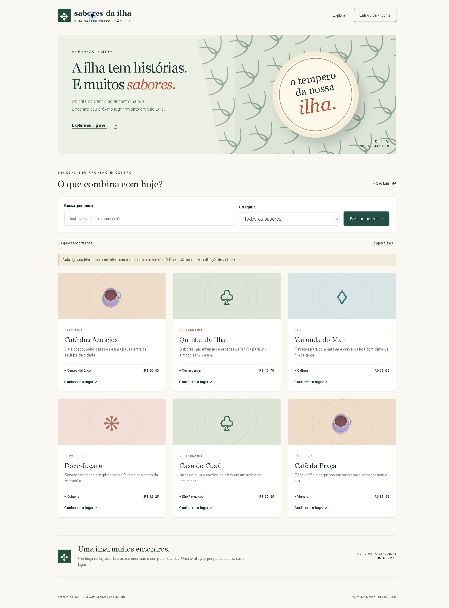

# Sabores da Ilha

Guia Gastronômico de São Luís · Desenvolvimento de Sistemas Web · UFMA · 2026.2.

Aplicação acadêmica em **HTML, CSS e JavaScript, sem frameworks**, com API REST do Supabase (PostgreSQL e Auth). A proposta citava React/Next.js; a implementação usa JavaScript puro para atender ao requisito explícito da Etapa 2.



## Funcionalidades

- Busca por nome, sem diferenciar acentos, e filtro por categoria.
- Detalhes com descrição, endereço, horário e faixa de preço.
- Cadastro por e-mail/senha, confirmação por e-mail e login.
- Avaliações públicas com nota de 1 a 5 e comentário de 3 a 500 caracteres.
- Uma avaliação por usuário/lugar; edição e exclusão apenas pelo autor.
- Layout responsivo, labels, diálogos, mensagens de erro e busca vazia.
- Plano B: catálogo local em data.js quando a API não responde.

**O catálogo tem seis estabelecimentos fictícios, incluindo endereços e horários.** Não é uma indicação de visita real. As avaliações são criadas pelos usuários; não há notas inventadas. O aplicativo não realiza reservas, pedidos ou pagamentos. O administrador gerencia os lugares pelo painel Supabase, sem painel administrativo dentro do aplicativo.

## Rodar localmente

1. Copie `config.example.js` para `config.js`.
2. Preencha `url` e `key` com a URL do projeto e sua chave **publishable**. Nunca use `service_role` ou uma chave secreta.
3. Em um projeto Supabase novo, execute `schema.sql` uma única vez no SQL Editor. O banco desta entrega já foi configurado.
4. Na pasta do aplicativo, execute:

```sh
python -m http.server 8000
```

No Windows também pode usar `py -m http.server 8000`, ou Live Server no VS Code. Abra http://localhost:8000. Não abra pelo protocolo file://.

Sem configuração, o catálogo local funciona em modo de demonstração. Login e publicação de avaliações exigem o serviço online; não são simulados offline.

## Estrutura e funcionamento

| Arquivo | Responsabilidade |
| --- | --- |
| index.html | Estrutura semântica, formulários e diálogos |
| styles.css | Identidade visual e responsividade |
| app.js | Eventos, DOM, fetch, autenticação e avaliações |
| data.js | Catálogo fictício do plano B |
| schema.sql | Tabelas, validações, RLS e catálogo inicial |
| config.example.js | Modelo de configuração sem chave |
| docs/ | Capturas, verificação e roteiro de apresentação |

Ao carregar, `fetch` consulta `GET /rest/v1/places`. A busca filtra o catálogo retornado por nome e categoria. Os detalhes consultam `GET /rest/v1/reviews`. Login usa `POST /auth/v1/token?grant_type=password`; avaliações usam POST, PATCH e DELETE com token de acesso. O banco decide quais operações são permitidas.

## Segurança

RLS habilitado nas duas tabelas; leitura pública; escrita no catálogo negada a usuários comuns. Avaliações exigem `auth.uid() = user_id`, inclusive após UPDATE. `UNIQUE(place_id,user_id)` impede duplicatas e CHECK valida nota e comentário. Dados digitados e recebidos entram no DOM com `textContent`, nunca `innerHTML`.

Senhas são enviadas por HTTPS ao Supabase e não são armazenadas pelo app. A sessão fica em sessionStorage, com renovação antes de operações autenticadas. `config.js` é ignorado pelo Git; não há chaves no código versionado ou no histórico. A chave publicável é visível no navegador por definição, mas não concede acesso administrativo: a proteção é imposta pelo RLS. O nome de exibição é escolhido pelo usuário e não comprova identidade real.

## Evidência da aba Rede

**Pendência antes da entrega:** anexar a captura real da aba Rede em `docs/rede.png` e inserir a imagem aqui. A captura da página inicial não substitui esse requisito.

Abra F12 → Rede/Network, recarregue a página e selecione `places?select=*&order=id.asc`. Em Cabeçalhos/Headers, capture **Request URL**, **Request Method: GET** e **Status Code: 200**. Não capture senhas ou tokens de login.

A requisição GET consulta a API REST externa do Supabase para obter o catálogo. O status 200 indica sucesso; a resposta JSON é transformada em cartões pelo JavaScript. As operações de login e avaliação são feitas por outras requisições.

## Verificação

Testados no navegador: catálogo online, busca sem acento, filtro, estado sem resultado, detalhes, formulários e layout móvel em 390 px. A API passou por testes de leitura pública, bloqueio anônimo, login, criação de avaliação, duplicata, nota inválida, edição, proteção do catálogo, exclusão e logout. A conta técnica utilizada é descartável e não faz parte da entrega. O recebimento de confirmação de cadastro exige e-mail real e não foi comprovado pelo teste técnico.

## Uso de IA

Foi utilizado ChatGPT/Codex para interpretar a atividade e a proposta, gerar a implementação inicial, integrar o Supabase, configurar SQL/RLS, apoiar testes e escrever documentação. O pedido foi construir o guia gastronômico com base nos dois documentos. A assistência incluiu produção substancial de código, não apenas revisão.

O aluno confirmou a criação de um projeto Supabase novo. A troca de frameworks por JavaScript puro, a identidade visual e o catálogo demonstrativo foram implementados com assistência de IA. Não são atribuídas ao aluno alterações manuais ainda não realizadas. Antes da entrega, revise o código e registre aqui eventuais alterações próprias; consulte `docs/APRESENTACAO.md` para estudar o funcionamento.

## Limites e referências

Trilha B: API externa do próprio projeto Supabase, com leitura pública; não é uma API pública de restaurantes de terceiros. O cadastro pode exigir confirmação por e-mail e está sujeito aos limites do serviço. A indisponibilidade da API aciona o catálogo local; não permite gravar avaliações offline.

Arte visual feita com CSS e símbolos tipográficos, sem imagens de terceiros ou fontes externas.

Documentação: [Supabase Auth](https://supabase.com/docs/guides/auth/passwords) e [RLS](https://supabase.com/docs/guides/database/postgres/row-level-security).
